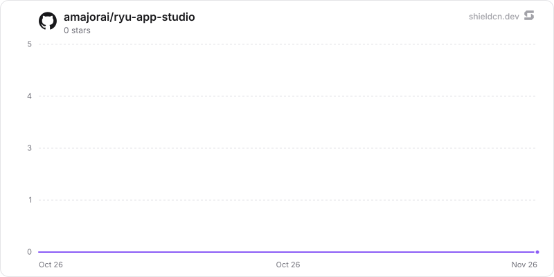

<div align="center">

# app-studio

</div>

Build your own Ryu apps with a drag-and-drop visual editor and chat edits, then install them as companion-only apps that stay disabled until you review their permissions.

> **The public home of `ryu-app-studio`.** Source, builds, and releases live here —
> binaries for every platform are attached to each release.
>
> This tree is generated from the Ryu monorepo, so commits pushed here
> directly are replaced on the next sync. **Pull requests are welcome** —
> open them here and they are ported into the monorepo, then flow back out.
> Ryu as a whole: https://github.com/amajorai/ryu

## Install

**App:** [Install](ryu://apps/com.ryu.app-studio) (opens the Ryu desktop app and asks you to confirm)

**CLI:**

```bash
ryu apps add com.ryu.app-studio
```

## Source & build

This is the **source of record** for the app UI. It imports Ryu's private
`@ryu/ui` design system, so it does **not** build standalone outside the
monorepo — it **builds inside the amajorai/ryu monorepo workspace**.
The **shipped bundle below is the built artifact**: a prebuilt single-file
companion bundle is included at [`dist/app-studio.ui.html`](./dist/app-studio.ui.html) —
the runnable UI Ryu loads for this app.

## License

Apache-2.0 — see [LICENSE](./LICENSE).

## What an App Studio app is

Each draft is one self-contained HTML document (inline CSS and JavaScript, no
network) plus a small manifest: name, description, and the permissions the app
may ask for. Installing it produces a normal companion-only Ryu App:

- id `com.local.app-studio.<name>`, one `kind:"companion"` runnable rendered
  from inline HTML (`ui_format:"html"`);
- no sidecar, backend, MCP server, hook or route, so building an app never
  starts a local process;
- only reviewed companion permissions: its own storage (`storage:kv`),
  notifications (`ui:toast`), your model (`hook:side-model`) and user-requested
  downloads (`files:download`).

The app installs through the host's `apps.installBundle` bridge (grant
`plugins:install`). The desktop host checks the bundle against App Studio's
own namespace before Core's generic install-bundle sink sees it, and Core
leaves a new install disabled. Enabling it from your Ryu apps is where its
permissions are reviewed and approved. Updates reuse the same id and bump the
patch version.

## Data

Drafts are stored in App Studio's own app storage. When the UI runs outside
Ryu (a standalone browser preview), drafts stay in browser storage and
installing is unavailable; the UI says so instead of pretending to save or
install.

The Preview panel runs the draft's scripts in an opaque-origin sandbox with a
CSP that blocks network loads. Ryu services such as storage are available only
after the app is installed and enabled.

## Build and test

```sh
bun run --cwd apps-store/app-studio/ui test
bun run --cwd apps-store/app-studio/ui check-types
bun run --cwd apps-store/app-studio/ui build
```

The UI build emits one self-contained `dist/index.html` for the sandboxed
Companion host. Refresh Core's compiled copy with
`scripts/sync-app-fixtures.sh app-studio`.

## Star History

<a href="https://github.com/amajorai/ryu-app-studio/stargazers">
  <picture>
    <source media="(prefers-color-scheme: dark)" srcset="./.github/shieldcn/star-chart-dark.svg" />
    
  </picture>
</a>
